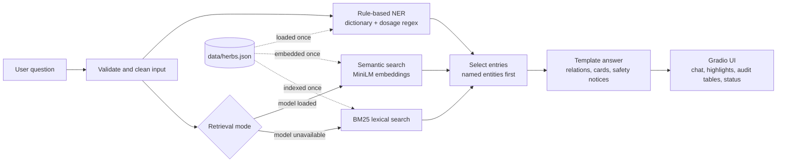

# AyurBot architecture

This document explains how AyurBot is put together, why the main design decisions were made, what the system cannot do, and how it could grow into a production system.

## Data flow

Everything to the right of the knowledge base is built once in `AyurBotService.__init__` (`src/service.py`): the JSON is parsed and validated, the NER patterns are compiled, the BM25 index is built, and, if possible, the embedding model is loaded and every entry is embedded. A question then costs one regex pass, one query embedding (or a BM25 scoring pass) and string formatting. On a laptop CPU that is typically a few milliseconds in lexical mode and tens of milliseconds in semantic mode.

## Modules

**`config.py`** holds every tunable value in a frozen `Settings` dataclass. Values come from defaults, then a local `.env` file, then real environment variables. Each value is range-checked; a bad value produces a warning and the default, so a typo never stops the app.

**`src/knowledge_base.py`** reads `data/herbs.json` as UTF-8 (a BOM is accepted, since Windows editors sometimes add one) and validates the whole file before using any of it. It reports all structural problems together with their location, so a student editing the file can fix everything in one pass. Dangling references (a herb pointing at a term id that doesn't exist) are warnings rather than errors. The module also derives two things from the entries: the NER lexicon (every canonical name, synonym, Devanagari form, English name, gloss and botanical name, each tagged with how it should be explained), and one searchable text document per entry for retrieval. Herb documents include the English glosses of their traditional-use terms, which is why a question about "cough" can find Tulsi.

**`src/text_utils.py`** contains `fold_with_map`, the function that keeps highlighting correct. It produces a case-folded, accent-free copy of the text plus a map from each folded character back to its original position. Matching runs on the folded copy and offsets are mapped back, so `Tulasī`, `TULSI` and a decomposed `Tulasi + U+0304` all match and still highlight exactly the characters the user typed. Latin accents are removed, but Devanagari vowel signs are deliberately kept, and they count as part of a word for boundary checks so that `वात` is not found inside `वाता`.

**`src/ner_engine.py`** is a rule-based recogniser, and the UI and code say so; it is not a trained model and does not invent confidence percentages. Each surface form is compiled once into a whole-word regex that tolerates extra spaces or hyphens. For a query, every pattern produces candidate spans; candidates are sorted longest first, then by category specificity (botanical name, herb, dosha, condition, property, concept, dosage), and accepted greedily if they don't overlap an accepted span. This gives "most specific match wins" behaviour (`Holy Basil` beats `Basil`) and guarantees no duplicates or overlaps. Each entity records its exact offsets, the method ("Exact dictionary match (synonym)", "Dictionary match (approximate English gloss)", "Dosage pattern match (regular expression)") and a sentence of evidence. Dosage mentions are recorded only as mentions.

**`src/retrieval_engine.py`** has two retrievers that share nothing. `SemanticRetriever` loads a Sentence Transformers model through an injectable factory, embeds all documents once with L2 normalisation, and answers queries with a single matrix-vector product. Its `initialize` method runs at most once; if loading fails, the state becomes `failed` with the reason, and no request ever triggers another load attempt. Encoding is guarded by a lock so concurrent Gradio workers cannot interleave model calls. If encoding fails at query time, that query is answered lexically; after three such failures the semantic retriever disables itself. `LexicalRetriever` is a pure-Python Okapi BM25 index with a light plural stemmer and stop-word list. BM25 ranks results, but filtering uses a separate, easier-to-explain number: the share of the query's informative words (weighted by inverse document frequency) found in the entry. Unknown query words count against coverage, so "weather in Pune" matches nothing instead of returning a random herb.

The default model factory tries `local_files_only=True` first, so a cached model loads without touching the network; only if that fails (and offline mode is off) does it download. Hugging Face timeouts are bounded through `HF_HUB_ETAG_TIMEOUT` and `HF_HUB_DOWNLOAD_TIMEOUT`.

Persistent embedding caching was considered and rejected for now. With about 60 short entries, embedding the whole knowledge base takes well under a second once the model is loaded, so a disk cache would add invalidation logic (model name, model revision, file hash) without a noticeable benefit. It becomes worthwhile past a few thousand entries; see the roadmap.

**`src/response_engine.py`** turns entities and retrieval results into Markdown using fixed templates. Entries the user named get full "cards"; retrieved entries get cards only when nothing was named, and otherwise are listed as related, so answers stay focused. When the question names a herb together with a dosha, condition term or property, the engine states the relationship recorded in the knowledge base, or states plainly that none is recorded. Safety handling is pattern-based and conservative: emergency language triggers an emergency-services notice; personal questions ("should I take", "I have", "my child") trigger a no-personal-advice notice; detected quantities or dose questions trigger a no-dosing notice; words such as "cure" or "treat" add a reminder that the data is traditional description only. Every answer ends with a short disclaimer, and a fuller one is permanently visible in the UI.

**`src/service.py`** wires everything together and is the only object the UI talks to. Startup never raises: a broken knowledge base puts the service in an error state in which every answer explains what to fix, and an unexpected exception during a question is logged and reported in the chat instead of breaking the session.

**`app.py`** builds the Gradio 6 interface. Submitting uses two chained events: the first appends the user message and clears the box immediately (no queue), and the second computes the answer and refreshes the highlights, tables and status. History is normalised on every turn (Gradio 6 returns message content as lists of text blocks) and capped at `AYURBOT_MAX_HISTORY_MESSAGES`. Before launching, the app finds a free port, starting from the configured one. SSR mode and analytics are turned off so Node.js is not needed and nothing is sent anywhere.

## Knowledge base design

The file has a `schema_version`, a `metadata` block and a flat `entries` list. Flat entries with string ids keep the file easy to edit by hand and make cross-references (herb → condition term, herb → dosha) simple to validate. Herb entries separate the canonical name, Sanskrit names, Devanagari forms, English name and synonyms, because NER explains each kind of match differently. Condition terms carry `approximate_english_terms` and a `mapping_note` stating that the classical term is not equivalent to a modern diagnosis (for example Prameha and diabetes, or Kushtha and leprosy).

All 56 entries are marked `"data_status": "demonstration"`. Their `source` fields describe how they were compiled and point to the Ayurvedic Pharmacopoeia of India as the place to verify them, but `reference` is deliberately `null`: no specific edition, page or study is cited, because none was checked. Safety notes are limited to widely reported cautions and are phrased as reasons to consult a professional, not as complete safety profiles.

## Known limitations

Rule-based NER only knows terms in the knowledge base; it does not handle misspellings ("Ashwaganda"), transliterations that aren't listed, or context (it cannot tell whether "Amrita" refers to Guduchi or is someone's name). The lexical fallback understands words, not meaning, so paraphrases without shared vocabulary may not match. Semantic scores from `all-MiniLM-L6-v2` are tuned for English; the 0.30 threshold is a reasonable starting point but has not been calibrated on a labelled evaluation set, and Hindi or Sanskrit queries in Devanagari rely mostly on NER. Answers are templates, so they read consistently but are not conversational, and the bot has no memory of earlier turns beyond what is displayed. Safety detection uses keyword patterns, which can miss unusual phrasings or flag harmless ones. The knowledge base is small, demonstration-grade and unreviewed by an Ayurveda expert or clinician. None of this has been clinically validated.

## Roadmap and delivery plan

The plan below separates the ideal solution from a minimum viable version and gives realistic timelines for the current team: one full-stack engineer, one backend and cloud engineer, and one frontend engineer and graphic designer, all partially allocated to other projects. The estimates assume about 40% of each person's time (roughly 2 days per week each, 6 person-days per week in total) and include code review, testing, bug fixing and deployment work, which typically take 30 to 40% of the effort.

### Ideal solution

The ideal production system would keep today's explainable pipeline and add: an expert-reviewed knowledge base with real citations and a review workflow (draft, reviewed, approved), stored in a database with an admin editing interface and version history; a trained or fine-tuned NER model (for example spaCy or a small transformer) used alongside the dictionary rules, with fuzzy matching for misspellings and a labelled evaluation set reporting precision, recall and F1; hybrid retrieval (BM25 and embeddings combined, then a cross-encoder re-ranker) with thresholds calibrated on a labelled relevance set, a multilingual embedding model for Hindi and Sanskrit, and a persistent embedding cache keyed by model revision and file hash; optional retrieval-augmented generation with a local or hosted LLM that is constrained to cite retrieved entries, with automated checks that every claim is grounded; a trained safety classifier in addition to the patterns, plus red-team test sets; a FastAPI backend separate from the UI, authentication, rate limiting, structured logging, metrics and error tracking; CI on every pull request (lint, type checks, unit tests, a model integration test, dependency vulnerability scanning) and containerised deployment with staging and production environments; and accessibility (WCAG 2.2 AA) and usability testing with real users.

### Minimum viable implementation

This repository is the minimum viable implementation for demonstration and coursework: validated JSON knowledge base, rule-based NER, semantic search with a lexical fallback, template answers with safety notices, an explainable Gradio interface, and an offline test suite. The smallest worthwhile next step is adding CI (GitHub Actions running pytest on Windows and Linux) and a 50 to 100 question labelled evaluation set, because every later improvement needs a way to measure whether it helped.

### Responsibilities without specialist roles

Several roles the ideal solution needs don't exist on this team, so their work has to be absorbed. **QA:** each engineer writes tests for their own changes, and the evaluation set is run in CI; this adds about 20% to feature estimates. **DevOps and SRE:** the backend and cloud engineer owns CI, deployment, monitoring and backups. **Security:** the backend engineer runs dependency scanning and a threat-model review before any public deployment. **Product management:** the full-stack engineer owns the backlog and priorities. **Data engineering and domain review:** knowledge-base curation needs a qualified Ayurveda practitioner and a clinician to review entries; this cannot be absorbed by engineers and is the most important external dependency. The risk is that this extra work competes with feature time, so the timelines below already include it.

### Realistic timeline for the current team

| Phase | Scope | Main owners | Realistic duration |
|---|---|---|---|
| 0. Stabilise | CI on Windows and Linux, evaluation set (50 to 100 questions), threshold calibration, bug fixes from first user feedback | Backend + full-stack | 2 to 3 weeks |
| 1. Better recognition | Fuzzy matching for misspellings, more transliterations, NER precision/recall report | Full-stack | 3 to 4 weeks |
| 2. Content | Expand to about 50 herbs with real citations and expert review; review status workflow in the JSON | Full-stack + external reviewer | 6 to 10 weeks (reviewer availability is the bottleneck) |
| 3. Retrieval quality | Hybrid BM25 + embedding ranking, cross-encoder re-ranking, multilingual model, persistent embedding cache | Backend | 4 to 6 weeks |
| 4. UI and accessibility | Accessibility audit and fixes, entry detail views, mobile polish, user testing with 5 to 8 people | Frontend/designer | 3 to 4 weeks (parallel with phase 3) |
| 5. Production readiness | FastAPI backend, authentication, rate limiting, logging and monitoring, containerised staging and production | Backend + full-stack | 6 to 8 weeks |
| 6. Optional grounded LLM | Constrained RAG answers with citation checking, behind a feature flag | Full-stack + backend | 6 to 8 weeks |

Phases 0 to 4 take roughly 4 to 6 months with parallel work; adding phases 5 and 6 brings a production-ready system to roughly 9 to 12 months. A production deployment that gives health information to the public should also include a legal and regulatory review, which is outside these estimates.
